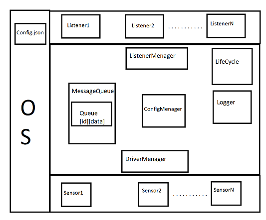
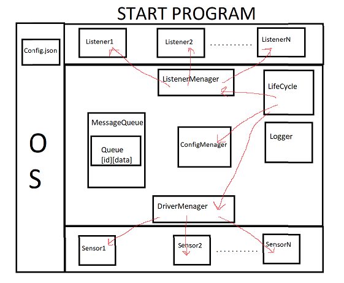
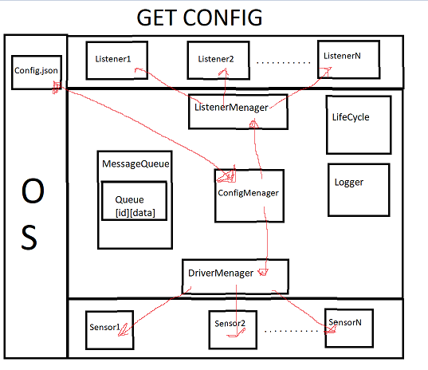
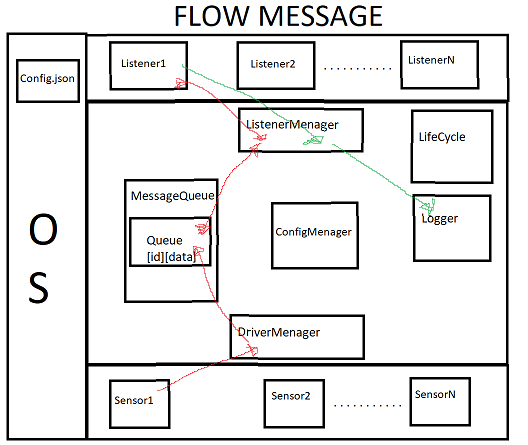

# Kongsberg - App

## Table of contents
1. [ Description ](#des)
2. [ Set config ](#config)
3. [ Architecture ](#archi)
4. [ Features ](#fea)
5. [ To-Dos ](#todo)
6. [ Results ](#res)

<a name="des">.</a>
## Description

In this task i have to create a program which one:
- Take config from json file
- Analize config file
- Create sensors with param from config file
- Create sensors listeners which one take all sensors data
- Wrapp data with special way
- Print wrapp data

Program was created and additional some feature was added(check below). 

<a name="config">.</a>
## Set config
An attempt has been made to support any bad json format. If any case this program will not work check json format this way:
- Key: "Sensors"
- Value: ID(UNIQUE Unsigned integer from 0 to 254)
- Value: Type: (string, name of sensor)
- Value: MinValue (integer, minimum value which can sensor create)
- Value MaxValue (integer, maximum value which can sensor create)
- Value: Alive (boolean, is sensor is turn off or turn on)
- Value: FrequencyHZ(unsigned integer, how fast you can take a data from sensor in Hz)
Example json config you can find in this repo [SensorConfig.json](https://github.com/GHRik/KongsbergApp/blob/master/KongsbergApp/SensorConfig.json)

<a name="archi">.</a>
## Architecture

   Architecture Perview 
     

   LifeCycle - module responsible for set other module to init, start, work and stop. 
   Logger - this module is responsible for logging on this moment on stdout.  
   ConfigMenager - responsible for parse and validate config from Config.json  
   ListenerMenager - responsible for create and menage listeners  
   DriverMenager - responsible for create and menage sensors  
   Sensor - responsible for symulate data and push this data on messageQueue[sensorID]  
   Listener - responsible for take data from messageQueue, corectly wrapp this data and log.  
   MessageQueue - have only queue inside the class, nothing special  
     

    

Any state like init, start, work and stop is propagate by LifeCycle. Any change of state is look are the same. On this example is START state. 
- Life Cycle send to Listener Menager, DriverMenager, ConfigMenager to START  
- ListenerMenager create listeners with they own thread  
- DriverMenager create sensors with they own thread  
 

    

  
 - ConfigMenager get config.json and properly parsed and validate   
 - To properly set Listeners ListenerMenager get from ConfigMenager needed config component.   
 - To properly set Sensors DriverMenager get from ConfigMenager needed config component.   
  

    

 
RED: 
- Sensor in his own thread push data on queue[SensorID]. Sensor push the data by DriverMenager. 
- Listener in his own thread pop data from queue[SensorID]. Listener pop the data by ListenerMenager. 
- Listener properly wrapp data. 
GREEN: 
- Wrapp data is logger on stdout by Logger which is component of ListenerMenager. 
 

<a name="fea">.</a>
## Feature
- Use [json library](https://github.com/nlohmann/json)
- Use json config
- Change json config during program run
- Validate json(key and values)
- Easy to change name of key and value in json(check [utils/config.hpp](https://github.com/GHRik/KongsbergApp/blob/master/KongsbergApp/utils/config.hpp))

<a name="Todo">.</a>
## ToDos
- Sometimes program stop. It can be a problem with vector. In my opinion in task like that should be avoid to use vectors. Circular buffer should be use.
- ErrorCode should be validate in all necessary function. On this moment some of functions who are return ErrorCode only return OK.
- All necessary pointers should be change on smart pointers.
- Function run() in ConfigLoader is so big. Should be split by functions.
- Create unit tests. Classes with function and parametrs should be mock.
- Delete unecessary pointer, value, log, etc.
- Add logging in any part. At first debugg logs.

<a name="res">.</a>
## Result

https://user-images.githubusercontent.com/30327297/186259908-50e1a169-2803-4384-a07b-71b67423bb08.mp4

https://user-images.githubusercontent.com/30327297/186260053-bdae202a-3a41-4ebc-8ee7-17ae96e5e34e.mp4

